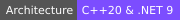

<div align="center">

<!-- 10-Language Navigation Bar -->
<p align="center">
  <a href="../README.md">🇺🇸 English</a> · <a href="./ko.md">🇰🇷 한국어</a> · <a href="./zh-CN.md">🇨🇳 中文</a> · **🇯🇵 日本語** · <a href="./es.md">🇪🇸 Español</a><br />
  <a href="./hi.md">🇮🇳 हिन्दी</a> · <a href="./ar.md">🇸🇦 العربية</a> · <a href="./pt-BR.md">🇧🇷 Português</a> · <a href="./ru.md">🇷🇺 Русский</a> · <a href="./fr.md">🇫🇷 Français</a>
</p>

<!-- Typing SVG Header (Repository Asset) -->
<a href="https://github.com/kLauncher1">
  
</a>

<p align="center">
  <strong>高性能ネイティブデスクトップソフトウェア、メモリサブシステム、超低遅延エンジンの設計。</strong><br />
  <sub>高精度 · 圧倒的パフォーマンス · 最小限のフットプリント — 確信に満ちたネイティブ工学。🚀</sub>
</p>

<!-- Status & Metadata Badges (Repository Assets) -->
<p align="center">
  
  
  
  
  
</p>

</div>

---

### ⚡ システムアーキテクチャ＆エンジニアペルソナ

```cpp
// [CORE-SPEC] Native Engineering Signature
namespace kLauncher1 {
    struct SystemsEngineer {
        static constexpr auto handle    = "kLauncher1";
        static constexpr auto name      = "Ken Park";
        static constexpr auto domains   = {
            "超高性能ネイティブデスクトップアプリケーション",
            "Direct2D 60FPS ハードウェアアクセラレーション戦術グラフィックス",
            "Win32 Interop、UI オートメーション、PE インジェクション",
            "バイナリ解析、リバースエンジニアリング、セキュリティフォレンジック"
        };
        static constexpr auto stack     = "C++20 · C# .NET 9 · x86/x64 ASM · CMake · WinAPI";
        static constexpr auto ethos     = "ゼロ肥大化、決定論的ランタイム、完全ハードウェアアクセラレーション。";
    };
}
```

---

### 🛠️ コア技術スタック (Technical Arsenal)

<div align="center">

#### システム言語＆コアランタイム
<p>
  
  
  
  
  
  
</p>

#### グラフィックス、Windows API、リバースツール
<p>
  
  
  
  
  
  
</p>

</div>

---

### 🚀 主要プロジェクト＆アーキテクチャ

| Project / System | Tech Stack | アーキテクチャ＆担当領域 |
| :--- | :--- | :--- |
| **StarCraft Omni Tactical Suite** | `C++20` · `C# WinForms` · `Win32` | 次世代ゲーミングランチャーおよびゲーム内メモリ/パケット制御 C++20 超軽量ネイティブエンジン |
| **FoxHop Radar Suite** | `C++20` · `Direct2D` · `WFP` | 60 FPS ハードウェア加速リアルタイム戦術マップ＆ UDP 6112 パケット解析 HUD オーバーレイ |
| **K-Star Launcher Pro** | `C# 13` · `.NET 9` · `UI Automation` | 100% バックグラウンド無人 Battle.net 自動ログイン＆ 63 モジュール疎結合アーキテクチャ |
| **Autonomous Kit & CI/CD** | `Node.js` · `PowerShell` · `REST API` | ゾンビプロセスゼロ化ライフサイクル＆ GitHub 9大タブ自動リリース管理パイプライン |

---

### 📊 テレメトリ＆コントリビューション統計

<div align="center">

<p align="center">
  
  
</p>

<p align="center">
  
</p>

</div>

---

### 📫 コンタクト＆ネットワーク

- 💬 **Ask me about**: 低レベルシステム、C++20、Win32 API、リバースエンジニアリング、UI 自動化
- 🌐 **GitHub**: [https://github.com/kLauncher1](https://github.com/kLauncher1)
- ⚡ **Engineering Fact**: 極小バイナリサイズ、鋭い応答性、不要なランタイム依存性ゼロ。

<div align="center">
  <sub>明瞭さ、精密さ、そして正統派エンジニアリングによって構築。🌟</sub>
</div>
