<div align="center">

<!-- 10-Language Navigation Bar -->
<p align="center">
  <a href="../README.md">🇺🇸 English</a> · <a href="./ko.md">🇰🇷 한국어</a> · <a href="./zh-CN.md">🇨🇳 中文</a> · <a href="./ja.md">🇯🇵 日本語</a> · <a href="./es.md">🇪🇸 Español</a><br />
  <a href="./hi.md">🇮🇳 हिन्दी</a> · <a href="./ar.md">🇸🇦 العربية</a> · **🇧🇷 Português** · <a href="./ru.md">🇷🇺 Русский</a> · <a href="./fr.md">🇫🇷 Français</a>
</p>

<!-- Typing SVG Header (Repository Asset) -->
<a href="https://github.com/kLauncher1">
  
</a>

<p align="center">
  <strong>Arquitetura de software desktop nativo resiliente, subsistemas de memória e motores de ultra baixa latência.</strong><br />
  <sub>Precisão · Desempenho · Pegada mínima — Engenharia nativa com convicção. 🚀</sub>
</p>

<!-- Status & Metadata Badges (Repository Assets) -->
<p align="center">
  
  
  
  
  
</p>

</div>

---

### ⚡ Arquitetura de Sistemas e Perfil de Engenharia

```cpp
// [CORE-SPEC] Native Engineering Signature
namespace kLauncher1 {
    struct SystemsEngineer {
        static constexpr auto handle    = "kLauncher1";
        static constexpr auto name      = "Ken Park";
        static constexpr auto domains   = {
            "Aplicações desktop nativas de altíssimo desempenho",
            "Gráficos táticos acelerados por hardware a 60 FPS via Direct2D",
            "Interop Win32, automação de interface e injeção PE",
            "Análise binária, engenharia reversa e perícia forense digital"
        };
        static constexpr auto stack     = "C++20 · C# .NET 9 · x86/x64 ASM · CMake · WinAPI";
        static constexpr auto ethos     = "Zero inchaço, tempo de execução determinístico, aceleração total de hardware.";
    };
}
```

---

### 🛠️ Arsenal Técnico Principal (Technical Arsenal)

<div align="center">

#### Sistemas e Linguagens
<p>
  
  
  
  
  
  
</p>

#### Gráficos, APIs do Windows e Engenharia Reversa
<p>
  
  
  
  
  
  
</p>

</div>

---

### 🚀 Principais Projetos e Foco Arquitetural

| Project / System | Tech Stack | Arquitetura e Responsabilidades |
| :--- | :--- | :--- |
| **StarCraft Omni Tactical Suite** | `C++20` · `C# WinForms` · `Win32` | Inicializador tático de próxima geração e motor nativo C++20 ultra-leve |
| **FoxHop Radar Suite** | `C++20` · `Direct2D` · `WFP` | Radar militar tático em tempo real a 60 FPS e overlay HUD de análise de pacotes UDP 6112 |
| **K-Star Launcher Pro** | `C# 13` · `.NET 9` · `UI Automation` | Login automático 100% em segundo plano no Battle.net e arquitetura fractal de 63 módulos |
| **Autonomous Kit & CI/CD** | `Node.js` · `PowerShell` · `REST API` | Ciclo de vida sem processos zumbis e pipeline automatizado de releases no GitHub |

---

### 📊 Telemetria e Atividade de Contribuição

<div align="center">

<p align="center">
  
  
</p>

<p align="center">
  
</p>

</div>

---

### 📫 Conexão e Contato

- 💬 **Ask me about**: Sistemas de baixo nível, C++20, Win32 API, Engenharia Reversa, Automação de UI
- 🌐 **GitHub**: [https://github.com/kLauncher1](https://github.com/kLauncher1)
- ⚡ **Engineering Fact**: Binários compactos, resposta imediata e zero dependências desnecessárias.

<div align="center">
  <sub>Desenvolvido com clareza, precisão e engenharia ortodoxa. 🌟</sub>
</div>
